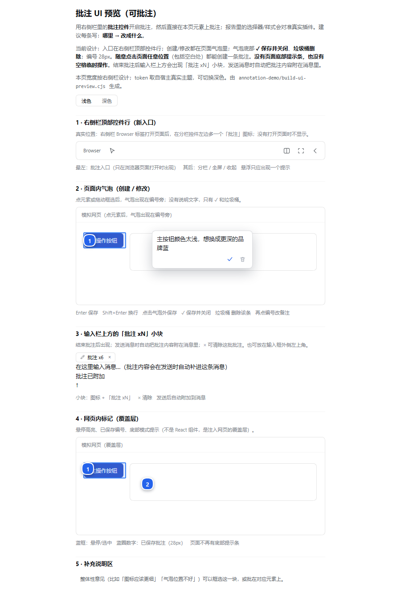

# dsh-web-annotation · 网页批注

在 DeepSeek Harness 桌面端**右侧边栏的 Browser 标签页**里批注网页：点选元素、点击空白位置或框选区域，写下修改意见；插件会自动保存截图与结构化报告，并把**合并后的批注报告随你的下一条消息一起发送**。

给"做的网页"或任意打开的网站提精确修改意见时，不用再截图、圈画、手打元素描述。

[](LICENSE)
[](https://github.com/deepseek-ai/deepseek-harness)




## 功能

- **连续批注**：点选元素、点空白位置（「点击位置」批注）、拖动框选区域，保存后可以接着批注下一条。
- **就地编辑**：气泡里输入意见，`Enter` 保存、`Shift+Enter` 换行、`Esc` 取消；已保存的批注点编号可重新编辑，✓ 保存、垃圾桶删除。
- **截图证据**：每条批注自动裁剪元素/区域截图（点击位置会带上下文），保存为 `NN.png`。
- **报告落盘**：每一批生成 `report.md`、`annotations.json` 和截图，存放在 `$DSH_HOME/annotations/<sessionId>/<timestamp>/`，方便模型和人工复查。
- **合并发送**：多次结束批注、多个页面得到的批注会合并成**一份总报告**（按页面分组，报告路径合并列出），不会再重复标题。
- **自动附加**：发送消息时由 Host 把报告并入**你正在发送的那条用户消息**——消息可见、可回放，模型也直接收到；插件不直接改写会话日志。
- **中途发送也完整**：批注模式还没结束就发送时，后台会先把这批批注落成截图/报告，随消息一起发出；消息被消费后自动退出批注模式，同一批批注不会重复附到下一条消息。
- **页面干扰抑制**：批注模式下一层透明捕获层挡住页面自身的悬浮弹层/链接跳转；跨域 iframe 可按整个元素/区域批注（内部元素受浏览器限制无法精确批注）。
- **轻量**：纯 JS，无构建、无运行时依赖，不改官方 Browser/Chat 提供方。

## 与同类插件的区别

DSH 社区已经有多款批注类插件（例如 [cslkkl/dsh-web-annotator](https://github.com/cslkkl/dsh-web-annotator)、[zhxnix/dsh-sidebar-annotations](https://github.com/zhxnix/dsh-sidebar-annotations)、[Shuffle-1992/dsh-browser-kit](https://github.com/Shuffle-1992/dsh-browser-kit)、[alaliqing/dsh-annotate](https://github.com/alaliqing/dsh-annotate)）。本插件刻意保持**窄而轻**：

- 只做"网页批注 + 截图 + 报告 + 随消息发送"，不接管官方 Browser/Chat/Layout 提供方，不附带浏览器自动化、DevTools、WebHID 等能力；
- 差异化在**证据与落盘**：每条批注都有截图和本地报告文件，批注报告作为普通消息文本随对话持久化；
- 代价是能力不如重型套件：没有源码映射/组件链、没有画布内对象标注、没有模型侧浏览器工具。

## 安装

要求：**DSH 桌面端 0.2.1-rc.2**（已在此版本实机验证）。插件需要 Host 半代码，安装/更新后要**重启 DSH**。

### 方式 A：插件管理页（桌面端推荐）

1. 从 [Releases](https://github.com/HXwHSJS/dsh-web-annotation/releases) 下载 `dsh-web-annotation-0.1.1.tgz`；
2. 打开 DSH 的**设置 → 插件**，使用安装入口选择本地 tgz / 填入 tgz 绝对路径安装（Desktop 的 `desktop` profile 由 Electron 管理，CLI 可能拒绝直接 `add` 它）；
3. 完全退出并重新打开 DSH。

### 方式 B：CLI 管理的 Web / Headless profile

```sh
dsh plugin --profile <profile> add \
  https://github.com/HXwHSJS/dsh-web-annotation/releases/download/v0.1.1/dsh-web-annotation-0.1.1.tgz
```

也可以直接从 GitHub 源码安装（无构建脚本，不需要 `allowBuilds`）：

```sh
dsh plugin --profile <profile> add github:HXwHSJS/dsh-web-annotation#<commit-sha>
```

安装后重启对应 profile 的 Host，刷新页面。

### 方式 C：本地开发

```sh
git clone https://github.com/HXwHSJS/dsh-web-annotation.git
dsh plugin --profile <profile> add "link:/absolute/path/to/dsh-web-annotation"
```

## 使用

1. 在会话右侧打开 **Browser** 标签页并访问任意 `http(s)` 页面；
2. 点击侧栏控件条上的**批注图标**（分栏/全屏按钮左侧）进入批注模式；
3. 点元素 / 点空白处 / 拖动框选，在气泡里写意见，`Enter` 保存；继续下一条；
4. 退出批注模式后，输入框上方出现「批注 xN」小块；
5. 正常输入并发送消息——批注报告会并入这条消息。

批注模式未退出就直接发送也可以：后台会保存当前批次并随消息发出，发送后自动退出批注模式。

## 发出的消息长这样

```text
网页批注（共 3 条）

页面：控制台（https://example.com/#dashboard）
页面源文件（推断）：./src/pages/dashboard.html
1. [元素] 「导出」：按钮颜色太浅，和背景对比度不够
2. [区域] 640×240：这块留白太大，压缩一半

页面：控制台（https://example.com/#settings）
3. [元素] 「点击位置」：这里想加一个「重置」入口

完整批注报告：C:\Users\<you>\.dsh\annotations\session-...\report.md；...
批注数据：...；...
截图目录：...；...
```

## 隐私与安全

- **无外网请求、无遥测**。插件的 HTTP 路由由本机 DSH Host 提供，只接收 DSH 页面发来的批注数据。
- 报告和截图只写入 `$DSH_HOME/annotations/<sessionId>/<timestamp>/`（默认 `~/.dsh/annotations`）。
- 批注文字与报告路径会作为用户消息的一部分发给模型，和用户自己输入的文字一样；截图默认留在本地。
- 批注模式会向当前 `<webview>` 注入运行时（`executeJavaScript`）并读取被批注页面的 DOM 信息；只在批注模式启用时运行。
- 安全模型与漏洞报告方式见 [SECURITY.md](SECURITY.md)。

## 已知限制

- 仅桌面端（依赖右侧边栏 Browser 的 Electron `<webview>`）；Web 版右侧栏是跨域 iframe，无法注入。
- 批注控件所在的那排侧栏按钮没有官方插件扩展位，靠实测 DOM 插入并持续校正；DSH 升级若改了这一排结构可能需要小修。
- 气泡固定用浅色卡片，暂不跟随宿主深色主题。
- 跨域 iframe 内部、closed Shadow DOM、Canvas 内部对象无法精确批注；iframe/Canvas 只能作为整体元素或区域批注。
- 页面导航/刷新后页面内标记会丢失（已落盘/已发送的报告不受影响）。
- 批注模式中途发送时，后台静默保存会为每次"批注集变化"生成报告目录；旧目录保留不自动清理（只有最新一份被消息引用）。
- 自动附加依赖 Host 的 `agent/pre-step` 与 DSH 会话日志接口，目前以 `0.2.1-rc.2` 为验证基线；更新 DSH 后请做一次"批注 → 发送 → 重启 → 会话能加载"的回归。

## 兼容性

| 项 | 值 |
| --- | --- |
| DSH | 0.2.1-rc.2（验证基线） |
| 平台 | Desktop（Windows 已验证；代码平台无关） |
| 运行时依赖 | 无 |
| 构建 | 无 |

## 开发

```sh
npm run check   # node --check index.js + client.js
npm test        # 离线运行时 harness（26 项）
npm run verify  # 两者
```

代码结构：

| 文件 | 作用 |
| --- | --- |
| `client.js` | Web 半：侧栏控件、输入框上方小块与桥、注入页面的批注运行时、报告合并、pending 同步 |
| `index.js` | Host 半：`/dsh-annotate/*` 路由、报告落盘、pending 批次、`agent/pre-step` 把批注并入用户消息 |
| `cordis.patch.yml` | bundle 插入 profile 的 loader 行 |
| `tests/runtime-harness.cjs` | 从 `client.js` 抽出 `runtimeMain()`，用 DOM 桩驱动 26 项检查 |
| `locale/*.json` | 插件管理页的标题与描述 |

贡献说明见 [CONTRIBUTING.md](CONTRIBUTING.md)，更新记录见 [CHANGELOG.md](CHANGELOG.md)。

## License

[MIT](LICENSE) © 2026 HXwHSJS

本项目是独立社区插件，与 DeepSeek 官方无隶属关系。

---

### English

Annotate pages in the DSH right-Sidebar Browser tab: click elements, blank
positions, or drag regions; write notes in an inline bubble; screenshots and a
Markdown/JSON report are saved under `$DSH_HOME/annotations`. Multiple batches
are merged into one report that is attached to your next sent message (durable
and visible in the chat). No build step, no runtime dependencies, no telemetry.
Requires DSH Desktop `0.2.1-rc.2`; restart DSH after install/update.
